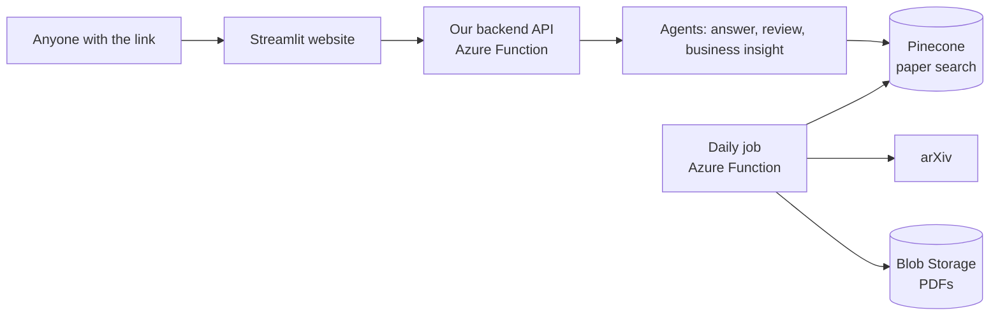
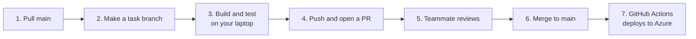

# Roadmap: Taking Our Project to the Cloud

**In one sentence:** the cloud resources are set up, so now each of us moves one piece of the pipeline from our laptops to the cloud, so anyone can use the app from a browser and new papers arrive automatically.

For step-by-step details on each task, see [docs/TASK_DETAILS.md](docs/TASK_DETAILS.md).

---

## 1. Today vs. where we're going

| | Today (our demo) | Goal (end of project) |
|---|---|---|
| **Papers** | PDFs downloaded by hand into `data/` | Pulled from arXiv **every day automatically** and saved in Azure Blob Storage |
| **Search database** | Chroma, a file on each laptop | **Pinecone**, one shared database in the cloud |
| **Embeddings** | bge model running on each laptop | **Azure OpenAI** `text-embedding-3-small` |
| **Answers** | Gemini answer plus reviewer check | Same, plus a **business insight agent** (opportunities, risks, industries, actions) |
| **Backend** | Python scripts on our laptops | **Azure Function App** (`arxivchron`) with an API |
| **Frontend** | Streamlit on a laptop | Streamlit on the **web**: a public link anyone can open |



---

## 2. The cloud resources we have (all set up and tested)

| Resource | What it is, in plain words | Used for |
|---|---|---|
| **GitHub `main` branch** | The official version of our code | Merging into `main` automatically deploys to Azure |
| **Azure Function App** `arxivchron` | A server that runs our Python code in the cloud when needed | Our API and the daily paper job |
| **Azure OpenAI** | Microsoft-hosted OpenAI models | Turning text into vectors (`text-embedding-3-small`) |
| **Pinecone** index `arxiv-papers` | A cloud database built for meaning-based search | Storing and searching paper chunks |
| **Blob Storage** `arxivpdfs` → `pdfs` | Cloud file storage, like Google Drive for code | Storing the PDFs |
| **Gemini** | Google's LLM | Writing answers, reviewing them, agent reasoning |
| **Streamlit Community Cloud** (not set up yet) | Free hosting for Streamlit apps | Our public website |

All keys are already saved in Azure (`arxivchron` → Environment variables). Locally, the same keys go in your `.env`.

---

## 3. Who does what (7 tasks, one per person)

| # | Task | In one line | Can start |
|---|---|---|---|
| 1 | **Cloud search database** | Switch embeddings to Azure OpenAI and storage to Pinecone | Now |
| 2 | **Cloud paper pipeline** | Fetch arXiv papers, save PDFs to Blob Storage, add them to Pinecone | Now (finishes after Task 1) |
| 3 | **Daily automatic ingestion** | Run Task 2 every day in Azure and monitor it | After Task 2 |
| 4 | **Backend API** | `/api/query` so the website can ask questions | Now, with fake data |
| 5 | **Multi-agent business insights** | Turn validated sources into business and market insights | Now, on the local pipeline |
| 6 | **Public website** | Streamlit calls our API and goes live on the web | Now, with fake data |
| 7 | **Quality and testing** | Re-run evaluation on the cloud version and add automatic tests | Now |

**How they connect:** Task 1 unlocks Tasks 2, 4 and 7. Task 2 unlocks Task 3. Tasks 4 and 5 feed Task 6.

**Timeline**

1. **This week:** Tasks 1, 5 and 7 start; Tasks 4 and 6 build against fake data.
2. **Next:** the cloud pipeline works end to end (Tasks 2, 3 and 4 use real data).
3. **Then:** agents appear in the website, and the website goes live (Tasks 5 and 6).
4. **Finally:** evaluation, polish, demo script and final presentation (everyone).

---

## 4. How we work: develop locally, push, deploy



### One-time setup

```bash
git checkout main && git pull
pip install -r requirements.txt
cp .env.example .env        # then fill in the values from Azure → arxivchron → Environment variables
```

### Every task

```bash
git checkout main && git pull                 # start from the latest code
git checkout -b task-1-pinecone               # one branch per task
# ...write code, run it locally...
git add -A && git commit -m "Describe the change"
git push -u origin task-1-pinecone            # then open a Pull Request on GitHub
```

After your PR is merged, GitHub Actions deploys `main` to Azure within a few minutes. Check that it worked in GitHub → **Actions**, and at `https://<our-app>/api/health`.

### Running things locally

| To test... | Run |
|---|---|
| Scripts (ingest, retrieve, agents) | `python ingest.py`, `python app.py` |
| The website | `streamlit run streamlit_app.py` |
| The API or the daily job, exactly as Azure runs them | `func start` (install Azure Functions Core Tools first) |
| Unit tests | `python -m pytest -q` |

---

## 5. Working with the cloud resources safely

Your laptop connects to the **same real cloud resources** the live app uses, so a few rules:

1. **Test writes in your own space.** When testing code that writes to Pinecone or Blob Storage, use a test namespace or folder (for example the Pinecone namespace `dev-yourname`, or the Blob folder `dev/yourname/`). Only the daily job and agreed backfills write to the real data.
2. **Reading is always fine.** Searching Pinecone, listing blobs and calling Azure OpenAI won't break anything.
3. **Never delete cloud data** (Pinecone index, Blob containers, Azure settings) without asking the group.
4. **Keys stay secret.** Keys go only in `.env` and Azure settings. Never commit them, paste them in chat, or show them in screenshots.
5. **Keep `main` demo-able.** Never push straight to `main`; always use a PR.
6. **Save quota.** Gemini's free tier only allows a small number of requests per day, so keep HyDE off and test with a few questions.

### Which task touches which resource

| Task | Azure OpenAI | Pinecone | Blob Storage | Function App | Gemini | Streamlit Cloud |
|---|:-:|:-:|:-:|:-:|:-:|:-:|
| 1. Cloud search database | ✅ | ✅ | | | | |
| 2. Cloud paper pipeline | ✅ | ✅ | ✅ | | | |
| 3. Daily ingestion | | | ✅ | ✅ | | |
| 4. Backend API | ✅ | ✅ | | ✅ | ✅ | |
| 5. Business insight agents | | | | | ✅ | |
| 6. Public website | | | | (calls API) | | ✅ |
| 7. Quality and testing | ✅ | ✅ | | | ✅ | |

### Where to look when something's wrong

| Question | Where |
|---|---|
| Did my deploy work? | GitHub → Actions tab |
| Is the app running? Errors? | Azure Portal → `arxivchron` → Monitoring / Application Insights |
| What's in our search database? | Pinecone console → `arxiv-papers` |
| Which PDFs do we have? | Azure Portal → `arxivpdfs` → Containers → `pdfs` |
| Which keys and settings? | Azure Portal → `arxivchron` → Environment variables (copy them into your `.env`) |

---

## 6. What "done" looks like

- [ ] Anyone can open our website link and ask a question
- [ ] Answers come from the cloud: Pinecone search, Gemini answer, reviewer check
- [ ] An "insight" mode gives business opportunities, risks and actions, all cited
- [ ] New arXiv papers show up every day without anyone running anything
- [ ] The evaluation shows the cloud version is as good as or better than the demo
- [ ] Every PR runs automatic tests before it can be merged

**Nice-to-haves after that:** date and category filters, a "what's new this week" page, answer feedback buttons, topic alerts by email or Slack, a trend dashboard, and exporting insights to slides. See [docs/TASK_DETAILS.md](docs/TASK_DETAILS.md#6-feature-roadmap-for-the-rest-of-the-project).
