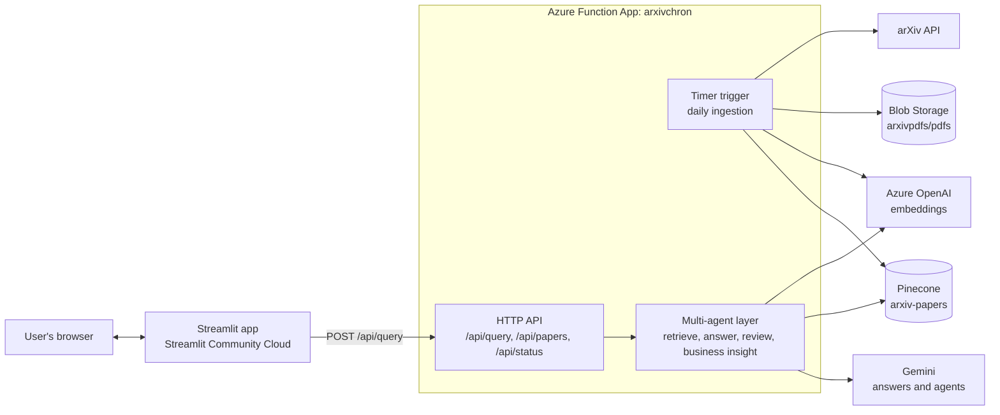
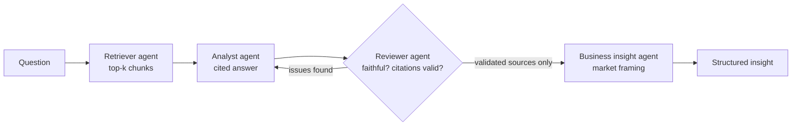
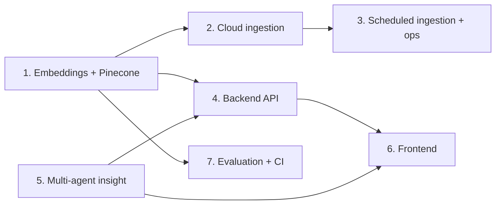

# Cloud Roadmap and Task Plan

How we go from today's local demo to a fully cloud-hosted research intelligence agent, split into 7 tasks so everyone owns one piece.

**TL;DR**
- The cloud resources are set up and verified: Azure Function App, Azure OpenAI, Pinecone, and Blob Storage. The config and keys are wired into the repo.
- The pipeline still runs locally: bge embeddings, local Chroma, PDFs in `data/`. That's what powers today's Streamlit demo.
- Next, we move each stage to the cloud, add scheduled ingestion and a multi-agent business-insight layer, and host the frontend so anyone can use it from a browser.

---

## 1. Where we are today

| Area | Status |
|---|---|
| Chunking (`chunk.py`) | Done: section-aware chunks with title, section, pages, authors, date, and PDF link |
| Retrieval (`retrieve.py`) | Done locally: bge embeddings, Chroma top-k search, optional HyDE query enrichment |
| Answer generation (`generate.py`) | Done: Gemini writes cited (`[n]`) business answers with a "Bottom line" |
| Reviewer agent (`reviewer_agent.py`) | Done: checks that claims are supported and citations are valid |
| arXiv fetching (`fetch_arxiv.py`, `pipeline.py`) | Done locally: saves PDFs to `data/` and re-ingests |
| Evaluation (`eval/`) | Done: 20-question benchmark, retrieval and generation metrics, report |
| Streamlit demo (`streamlit_app.py`) | Done locally: Ask, Fetch, and Evaluation tabs, running everything in one process |
| Azure Function App `arxivchron` | Deployed from `main` by GitHub Actions; only `/api/health` exists so far |
| Azure OpenAI | `text-embedding-3-small` deployment works (1536 dimensions) |
| Pinecone | Index `arxiv-papers` exists (1536 dimensions, cosine metric) and is empty |
| Blob Storage | Account `arxivpdfs`, container `pdfs`, empty |
| Config | `config.py` and `.env.example` have every cloud setting; all values are set in Azure |

### Setup for everyone (do this first)

1. Run `git checkout main && git pull`.
2. Run `pip install -r requirements.txt`.
3. Copy `.env.example` to `.env` if you haven't already. Fill in the "Cloud resources" section with the values from Azure Portal → `arxivchron` → Environment variables.
4. Keep `EMBEDDING_MODEL=BAAI/bge-base-en-v1.5` until Task 1 is merged, so the local demo keeps working.
5. Never commit `.env` or paste keys into chat or screenshots.

---

## 2. Target architecture



**How a question flows:** the user asks in Streamlit, which calls `/api/query` on our function app. The function embeds the question (Azure OpenAI), searches Pinecone, writes an answer (Gemini), validates it (reviewer agent), turns validated findings into business insights (insight agent), and returns JSON. Streamlit then renders the result.

**How papers get in:** every day the timer pulls new arXiv papers, saves the PDFs to Blob Storage, chunks and embeds them, and upserts the chunks into Pinecone. No laptop required.

---

## 3. Shared contracts (agree on these so we can work in parallel)

These are the "handshakes" between tasks. If you need to change one, tell the owners of the tasks that use it.

### Pinecone record (used by Tasks 1, 2, 4, 5)

```text
id:       chunk_id                      e.g. "2608.20316_s00_c00"
values:   1536-dim text-embedding-3-small vector
metadata: paper_id, title, authors, published, published_ts, categories, pdf_url,
          section_label, section_path, chunk_index, page_start, page_end,
          text   <- the chunk itself (Pinecone has no separate document store)
```

`search()` keeps returning the same dict it returns today: `chunk_id, paper_id, title, authors, published, pdf_url, section_label, section_path, page_start, page_end, text, score`.
**`score` stays a cosine distance (lower = more similar).** Pinecone returns a similarity, so convert with `distance = 1 - similarity`. Then the frontend and the evaluation code don't need to change.

### Blob Storage layout, container `pdfs` (used by Tasks 2, 3, 4)

```text
papers/{paper_id}.pdf      the PDF
meta/{paper_id}.json       arXiv metadata record (same fields fetch_arxiv.py writes today)
catalog.json               list of all ingested papers (powers /api/papers and the paper filter)
runs/{timestamp}.json      one summary per ingestion run (powers /api/status)
```

### `POST /api/query` (used by Tasks 4, 5, 6)

```jsonc
// request
{
  "question": "How can businesses reduce LLM costs?",
  "k": 5,
  "use_hyde": false,
  "mode": "answer",                       // "answer" or "insight"
  "filters": { "paper_ids": [], "published_after": "2026-08-01" }
}

// response
{
  "question": "...",
  "answer": "Markdown answer with [1][2] citations. Bottom line: ...",
  "review": { "faithful": true, "citations_valid": true, "issues": [] },
  "insight": null,                        // filled when mode = "insight" (see Task 5)
  "sources": [ { "chunk_id": "...", "title": "...", "authors": "...", "published": "...",
                 "pdf_url": "...", "section_path": "...", "page_start": 1, "page_end": 2,
                 "text": "...", "score": 0.41 } ],
  "timings": { "retrieve": 0.4, "generate": 3.1, "review": 2.2 }
}
```

Auth: callers send the function key in the `x-functions-key` header. The Streamlit app keeps it in `st.secrets`, so users never see it.

---

## 4. The 7 tasks

Each task lists its goal, the steps, the files it touches, and how we know it's done. Owners: write your name in.

### Task 1: Embeddings and vector store move to the cloud
**Owner:** ________ · **Depends on:** nothing (start now) · **Blocks:** Tasks 2, 4, 5

**Goal:** Embed with Azure OpenAI and store and search in Pinecone instead of local bge and Chroma.

Steps:
1. `embed.py`: replace SentenceTransformer with Azure OpenAI. A tested version (works with our `/openai/v1` endpoint):
   ```python
   from urllib.parse import urlparse
   from openai import OpenAI
   import config

   _client = None

   def get_client():
       global _client
       if _client is None:
           host = urlparse(config.AZURE_OPENAI_ENDPOINT).netloc
           _client = OpenAI(base_url=f"https://{host}/openai/v1/", api_key=config.AZURE_OPENAI_KEY)
       return _client

   def embed_texts(texts, show_progress_bar=False):
       out = []
       for i in range(0, len(texts), 100):
           resp = get_client().embeddings.create(model=config.EMBEDDING_MODEL, input=texts[i:i + 100])
           out.extend(d.embedding for d in resp.data)
       return out
   ```
2. `store.py`: replace Chroma with Pinecone: `upsert` in batches of about 100, and keep `chunk_metadata()` plus a `text` field.
3. `retrieve.search()`: call Pinecone `query(vector, top_k=k, include_metadata=True, filter=...)` and convert the scores to distances. Pinecone filters use the same `$in`, `$gte` and `$lte` syntax as Chroma.
4. Change `EMBEDDING_MODEL` to `text-embedding-3-small` in the `config.py` default, in `.env.example`, and in everyone's `.env`. The bge query prefix turns off automatically.
5. Backfill: run `python ingest.py` once to load the existing 136 chunks into Pinecone.

**Done when:** `retrieve("How can businesses reduce LLM costs?")` returns Pinecone results with the same fields as today, and the tests pass.
**Note:** in a test run, `text-embedding-3-small` matched bge's accuracy (paper Hit@1 0.90, section Hit@5 0.90) and separated off-topic questions much better.

---

### Task 2: Cloud ingestion (arXiv → Blob Storage → Pinecone)
**Owner:** ________ · **Depends on:** Task 1 for the final upsert step · **Blocks:** Task 3

**Goal:** One function, `ingest_new_papers(days=2, max_results=50)`, that fetches new papers and stores everything in the cloud, with no writes to the project folder.

Steps:
1. Refactor `fetch_arxiv.fetch()` to yield `(record, pdf_bytes)` instead of writing to `data/`. Keep the command-line tool working by having its `main()` save the bytes to `data/` as it does today.
2. "Already ingested?" checks look for `meta/{paper_id}.json` in Blob Storage instead of the local folder.
3. Upload `papers/{paper_id}.pdf` and `meta/{paper_id}.json`, and update `catalog.json`.
4. Chunk from a temporary file in `/tmp` (pdfplumber needs a file path), then embed (Task 1) and upsert to Pinecone.
5. One-time: upload the 5 existing PDFs and their metadata from `data/` so the cloud and the demo match.
6. Return a run summary (papers found, ingested, failed, chunks added) and save it to `runs/{timestamp}.json`.

**Done when:** running `ingest_new_papers(days=2, max_results=5)` from a laptop adds PDFs to the `pdfs` container and vectors to Pinecone, and running it again adds nothing.

---

### Task 3: Scheduled ingestion and cloud operations (the "regular ingestion")
**Owner:** ________ · **Depends on:** Task 2 · **Pairs with:** Task 4 (same `function_app.py`)

**Goal:** New papers flow in automatically every day, and we can see whether it worked.

Steps:
1. Add a timer function to `function_app.py`:
   ```python
   @app.timer_trigger(schedule="0 0 6 * * *", arg_name="timer")   # 06:00 UTC daily
   def daily_ingest(timer: func.TimerRequest) -> None:
       summary = ingest_new_papers(days=2, max_results=100)
       logging.info("ingestion summary: %s", summary)
   ```
2. Set `"functionTimeout"` in `host.json` (for example 30 minutes), and keep each run small enough to fit.
3. Local testing: install Azure Functions Core Tools (`brew install azure-functions-core-tools@4`) and Azurite, then run `func start`.
4. Once Task 1 is merged, remove `sentence-transformers` and PyTorch from `requirements.txt`, so the Azure build gets much smaller and faster.
5. Monitoring: check runs in Application Insights (already connected) and alert on failures.
6. Security: rotate the storage key (key1). Optionally move secrets to Key Vault.

**Done when:** the timer runs in Azure, new papers appear in Blob Storage and Pinecone the next day, and a run summary is visible.

---

### Task 4: Backend API
**Owner:** ________ · **Depends on:** Task 1 (can start with mock data) · **Blocks:** Task 6

**Goal:** A clean HTTP API the frontend (or anything else) can call.

Steps:
1. `POST /api/query`: implement the contract in section 3 (retrieve, then answer, then review, plus insight when `mode = "insight"`).
2. `GET /api/papers`: return `catalog.json`, which feeds the frontend's paper filter.
3. `GET /api/status`: return the last ingestion run, paper count and chunk count.
4. Validate inputs, return clear 4xx and 5xx JSON errors, and handle Gemini rate limits gracefully.
5. Unit tests with fake Pinecone and Gemini clients, plus a `curl` example in the README.

**Done when:** `curl -X POST https://<app>/api/query -H "x-functions-key: ..." -d '{"question":"..."}'` returns the contract JSON from the deployed app.
**Tip:** build the endpoint with hard-coded sample JSON first, so Task 6 can start immediately.

---

### Task 5: Multi-agent business insight layer (Jenna's proposal)
**Owner:** ________ · **Depends on:** nothing to prototype (works on the local pipeline); Task 4 to expose it · **Blocks:** the insight view in Task 6

**Goal:** Turn validated research findings into market and business insights a KPMG advisor could use, and make the agent usable through the API and frontend.

How the agents work together:



Steps:
1. Orchestrator function (for example `agents.py: run_insight(question, k)`) that chains the existing pieces. If the reviewer flags issues, retry the analyst once with the reviewer's feedback, then pass only supported claims and their sources onward.
2. Business insight agent prompt and output:
   ```json
   {
     "summary": "...",
     "business_relevance": "...",
     "industries": ["Financial services", "Healthcare"],
     "opportunities": ["... [1]"],
     "risks": ["... [2]"],
     "maturity": "research | early adoption | production-ready",
     "recommended_actions": ["..."],
     "confidence": "low | medium | high"
   }
   ```
   Every claim must cite `[n]` from the validated sources. No outside facts.
3. Make it usable: expose it as `mode = "insight"` in `/api/query` (with Task 4), and render it in the frontend (with Task 6).
4. Add 5–10 benchmark questions for insight mode (with Task 7).

**Open question for the team:** "market research" here means framing the research for markets and industries using only our papers. Pulling in real market data (market sizes, company news) would need a new data source; that's a stretch goal.

**Done when:** `run_insight("How can banks use AI agents?")` returns valid JSON in which every claim cites a validated source, and it's callable through the API.

---

### Task 6: Frontend (public website)
**Owner:** ________ · **Depends on:** Task 4 (start against mock JSON) · **Pairs with:** Task 5

**Goal:** Anyone with the link can use the app from a browser, backed by our cloud API.

Steps:
1. Move the app to `frontend/streamlit_app.py` with its own `frontend/requirements.txt` (just `streamlit` and `requests`). This keeps the frontend light.
2. Replace the direct pipeline imports with one `requests.post(f"{BACKEND_URL}/api/query", ...)` call. Remove the local model, the index build and the Fetch tab, since the cron job replaces fetching.
3. Add an "Insight" view for Task 5's output: summary, industries, opportunities, risks, actions, confidence.
4. Use `/api/papers` for the paper filter, add date and category filters, and show "last updated" from `/api/status`.
5. Fix the distance badge thresholds for the new embedding model, or show "relevance %" instead.
6. Deploy on Streamlit Community Cloud from `main`, and add `BACKEND_URL` and `BACKEND_KEY` in its Secrets.

**Done when:** a public `*.streamlit.app` link answers questions using the cloud backend, with no local files.

---

### Task 7: Evaluation, quality and CI
**Owner:** ________ · **Depends on:** Task 1 (to re-run the benchmarks) · **Supports:** everyone

**Goal:** Prove the cloud version is as good as or better than the demo, and catch breakages automatically.

Steps:
1. Re-run `python eval/run_eval.py` on the cloud stack, and compare it with the bge baseline in the report.
2. Add a relevance cutoff: if the best match's distance is above the threshold, answer "No relevant research found" instead of guessing. The new model separates off-topic questions clearly: worst relevant distance 0.61 vs closest off-topic distance 0.73.
3. Extend the eval to insight mode (business usefulness, citation validity), together with Task 5.
4. Add a GitHub Actions job that runs the unit tests on every pull request, and require it to pass before merging and deploying.
5. Prepare the evaluation slides and metrics for the final presentation.

**Done when:** the eval report covers the cloud stack and insight mode, and pull requests show a green test check.

---

## 5. Order of work



Tasks 1, 5, 7 (the CI part), and the mock-data versions of Tasks 4 and 6 can all start immediately.

| Phase | Goal | Tasks |
|---|---|---|
| **Phase 1: Foundations** (this week) | Pinecone and Azure OpenAI live; API skeleton with mock JSON; agent prototype on the local pipeline; CI tests | 1, 4 (mock), 5 (prototype), 6 (against mock), 7 (CI) |
| **Phase 2: Cloud pipeline** | Ingestion writes to Blob Storage and Pinecone; the timer runs daily; `/api/query` uses real data | 2, 3, 4 |
| **Phase 3: Agents and public app** | Insight mode in the API and UI; frontend hosted on Streamlit Cloud | 5, 6 |
| **Phase 4: Polish and present** | Evaluation of the cloud stack and agents, relevance cutoff, demo script, final report | 7, everyone |

**Rule:** `main` must always stay demo-able. Work on a branch per task, open a PR, get one review, then merge.

---

## 6. Feature roadmap for the rest of the project

**Must have (the project isn't done without these)**
- Fully cloud-hosted pipeline: Pinecone, Azure OpenAI embeddings, Blob Storage
- Regular (daily) automatic ingestion of new arXiv papers
- Public web app backed by the cloud API
- Multi-agent business insight mode with validated, cited sources
- Evaluation of retrieval, answers and insights, plus human review

**Should have (high value, moderate effort)**
- Filters by date, category and paper
- "What's new this week" page summarizing newly ingested papers
- A "no relevant research found" response instead of weak answers
- Thumbs up or down feedback on answers, saved for evaluation
- Caching repeated questions to save LLM quota and time

**Could have (stretch goals)**
- Personalized research alerts: subscribe to a topic and get an email or Slack digest
- Trend dashboard: which AI topics are growing over time
- Compare two papers side by side
- Export an insight to PDF or slides for client conversations
- Multi-turn chat with follow-up questions
- Sources beyond arXiv, such as company blogs or industry reports

---

## 7. Risks and open questions

| Risk | Mitigation |
|---|---|
| Gemini free-tier quota (about 20 requests per day per model) can run out during demos | Cache answers, keep HyDE off by default, or discuss moving generation to an Azure OpenAI chat model |
| Ingestion runs exceed the function timeout | Small daily batches; larger backfills run from a laptop with the same function |
| Leaked keys | Keys only in `.env` and Azure settings; rotate the storage key (Task 3); never paste keys anywhere |
| Breaking the demo while migrating | Task branches, PR reviews, CI tests, and keep `main` demo-able |
| "Market research" scope is unclear | Decide as a team: papers-only business framing (planned) vs adding real market data (stretch) |
